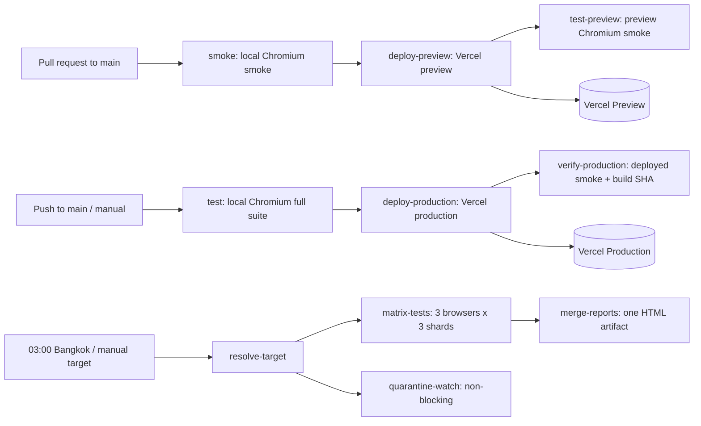

# PIPELINE.md — CAMT Bookshop

Student ID: **TODO(USER)**

Name: **TODO(USER)**

Repository: <https://github.com/YaGami-Light666/camt-bookshop>

Production URL: <https://camt-bookshop-lz482534829-9647.vercel.app>

## 1. Pipeline at a glance

## 2. Evidence

The following evidence must be added after the GitHub and Vercel account steps have run.

| AC | What | Link / screenshot |
|---|---|---|
| AC-03.2 | Vercel deployments were made by Actions | TODO(USER): Vercel deployment-list screenshot |
| AC-03.4 | Vercel Authentication on and automation bypass created | TODO(USER): protection-settings screenshot |
| AC-04.3–4 | Green PR gate with preview URL | TODO after first green PR run |
| AC-04.6 | Warm-cache PR duration | TODO after second PR run |
| AC-05.1–3 | Branch protection / ruleset | TODO(USER): ruleset screenshot |
| AC-05.4 | PR blocked by a red required check | TODO after deliberate red-gate experiment |
| AC-06.3–4 | Green production deployment and verification | [Main pipeline run 41344916675](https://github.com/YaGami-Light666/camt-bookshop/actions/runs/41344916675) |
| AC-06.7 | Red main test with deployment skipped | TODO after PR-42 is merged |
| AC-07.2 | Manual nightly runs for production, URL and local | TODO after three manual runs |
| AC-08.2 | Quarantine issue | <https://github.com/YaGami-Light666/camt-bookshop/issues/1> |

## 3. Timings

| Run | Cold cache | Warm cache | Budget | Within? |
|---|---:|---:|---:|---|
| PR gate | TODO | TODO | 8 min | TODO |
| Main pipeline | 2 min 6 sec | TODO | 10 min | Yes |
| Nightly, production | TODO | TODO | 20 min | TODO |
| Nightly, local | TODO | TODO | 20 min | TODO |

Browser-cache saving: **TODO after comparable cold and warm runs.**

Production versus local nightly: **TODO after both runs; local also pays the build/start cost on every matrix runner, while production pays network latency.**

## 4. Triage record — quarantined test

| | |
|---|---|
| Symptom | The cart sometimes shows `Exchange rate unavailable` instead of the USD total. |
| Local measurement | 7 passed / 3 failed out of 10 Chromium runs |
| Classification | Environment / unreliable external exchange-rate service |
| Deciding evidence | The failing Playwright trace records `GET /api/rates` returning HTTP 503 `rates service unavailable`. |
| Containment | Tagged `@quarantine`, annotated with issue and expiry, excluded from blocking jobs, retained in nightly `quarantine-watch`. |
| Cure | Replace it later with controlled `page.route` success and outage tests. |
| Expiry date | 2026-11-15 |

## 5. The teammate's pull request (PR-42)

1. PR gate prediction: both smoke jobs pass and a preview is deployed because the boundary-price test is not tagged `@smoke`.
2. Main prediction: the full-suite test job fails at `member discount applies at exactly 2,000 THB`; production deployment is skipped.
3. Production prediction: no new Vercel production deployment is created and the previous good build remains live.
4. Restoration plan: use GitHub's Revert action, let the PR gate pass, merge the revert, and verify the next main run deploys.
5. Decision: tag the boundary test `@smoke`; it adds little time and catches this high-value pricing boundary before merge without running the entire suite twice.

## 6. Think-first answers

1. Predicted 6/10 passes. Actual 7/10. Classification: environment. Evidence: the trace shows `GET /api/rates` returned HTTP 503.
2. `.vercel/` would expose project/account linkage and pulled environment files; `blob-report/` would commit generated mergeable CI reports; `.env` would commit local credentials and configuration.
3. Without `{ retry: 0 }`, `$fetch` retries a failed GET once, so the visible failure probability is `0.35² = 12.25%`. An application retry hides the dependency failure and changes product latency without Playwright marking a flaky attempt; Playwright retries remain visible in reports and traces.
4. No. The password remains in Git history and existing clones. A real team must revoke/rotate it immediately, purge it from history (for example with `git filter-repo`), force-push the repaired history, and tell collaborators to re-clone.
5. With two retries: `0.35³ = 4.2875%`. With five retries: `0.35⁶ ≈ 0.1838%`. Still no: more retries mask a known unreliable dependency, waste time and make a green gate less trustworthy.
6. Vercel's Git integration could deploy the merged bug independently while the main Actions test is red; customers would see the broken build. Disabling automatic Git deployment keeps production behind the tested pipeline.
7. A private window shows Vercel Authentication because the preview is protected. Without a bypass the tests reach that login wall and fail before the app. The choices are disable protection or send the automation-bypass header; PL-03 chooses the bypass so previews stay private.
8. GitHub can offer a required check only after that job name has been registered by a workflow run. If the YAML later becomes invalid, the workflow never starts and the required checks remain expected/pending, so merging stays blocked.
9. The PR gate should pass; the main pipeline should fail. Somchai changed the discount boundary from `>= 2000` to `> 2000`; the non-smoke boundary test catches it, while his four smoke tests do not cover exactly 2,000 THB.
10. Tagging the boundary test `@smoke` is fast and targets a high-risk business rule, but grows the smoke set. Running the full suite on every preview gives broader deployment confidence, but duplicates work and risks the 8-minute PR budget. Decision: tag this boundary test `@smoke`.

## 7. One thing I would change

I would replace the probabilistic exchange-rate test with deterministic contract tests that intercept `/api/rates` for both success and outage responses. I would measure success by a zero flake rate over 100 repeated CI runs while preserving assertions for both user-visible states.
